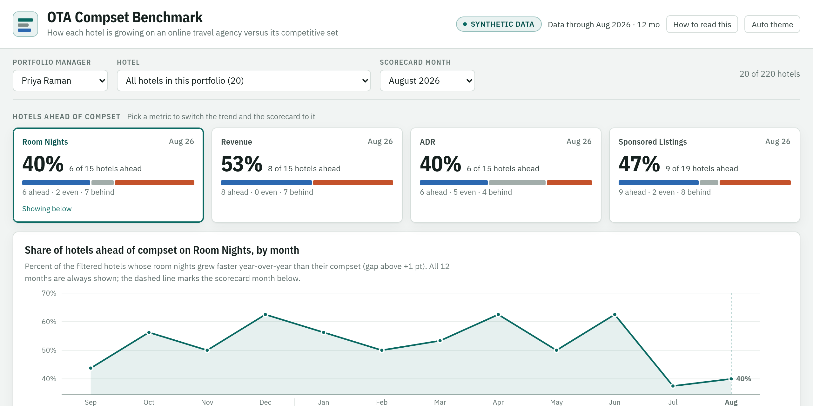
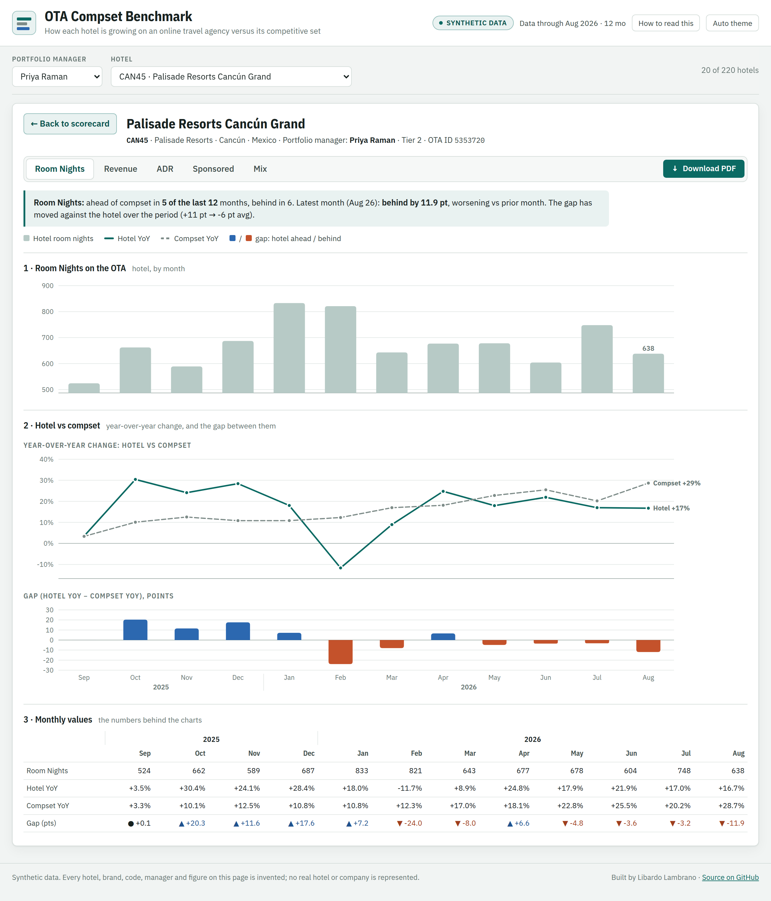
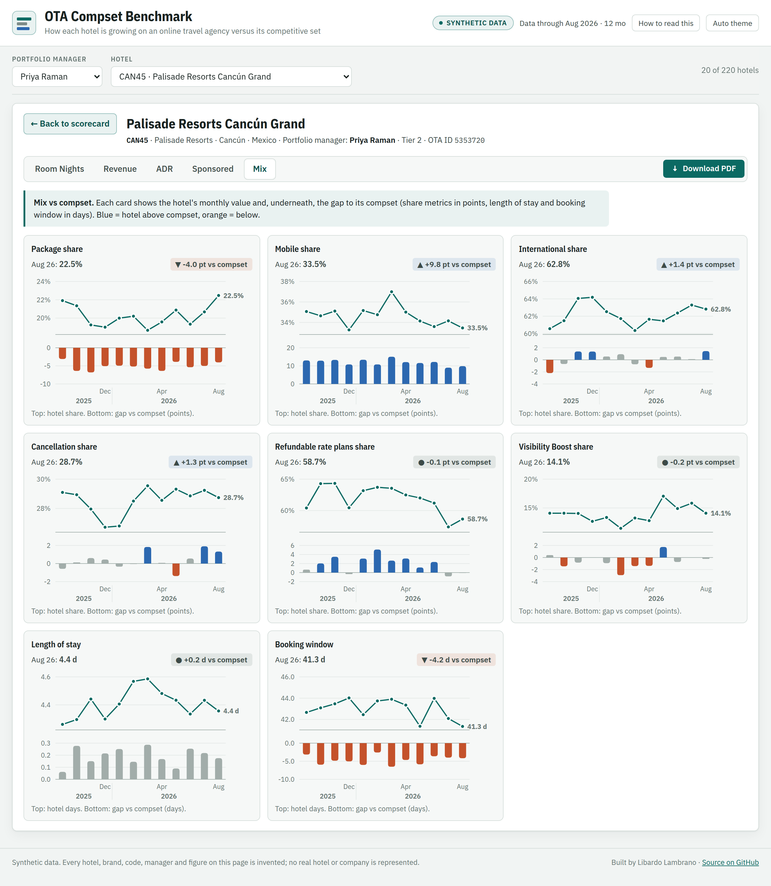

# OTA Compset Benchmark

An interactive benchmark of how each hotel in a portfolio is performing on an
online travel agency (OTA) against its competitive set: room nights, revenue,
ADR and sponsored-listing share, plus the booking-mix comparisons (package,
mobile, international, cancellations, refundable rates, length of stay,
booking window). It answers the question a field commercial team asks every
month: *which of my hotels are gaining share of the channel, and which are
losing it?*



**[Open the live demo →](https://llambrano.github.io/hotel-ota-compset-benchmark/)**

One self-contained HTML file, served by GitHub Pages. No server, no build step
at view time, no database. Clone the repo and open `index.html` and you get
the same page offline.

---

## The data on this page is synthetic

The working version of this report reads an OTA's monthly partner production
extracts. Those figures belong to the OTA and to the hotels, so none of them
appear here. Every hotel, brand, hotel code, OTA ID, portfolio manager and
number in this repository is invented by
[`scripts/make_synthetic.py`](scripts/make_synthetic.py): same shape as the
real payload, same statistical character, no real measurements. The page says
so in its masthead, footer, help panel and on every page of the PDF report,
and the build refuses to run if any of those disclaimers goes missing.

What the generator models, and why each part earns its place:

| | |
|---|---|
| **Hotel size** | Lognormal monthly room nights. Small hotels swing much harder year over year, which is exactly the noise the page has to help a reader see past. |
| **Seasonality** | Separate demand shapes for city, resort and airport hotels, peaking in different months. |
| **Market trend** | One compset growth path per market, shared by every hotel in it, so hotels in the same market are judged against the same tide. |
| **Hotel skill** | A persistent gap to compset plus AR(1) month-to-month drift. Without persistence, "ahead in 9 of the last 12 months" would be coin flips; with it, the scorecard sorts real outperformers from lucky months. |
| **Openings** | A few hotels open mid-window. With no prior year they have no YoY and no gap, and the page has to handle that honestly instead of showing a zero. |
| **Mix metrics** | Share-of-bookings levels with a persistent offset to compset, and a share of hotels not enrolled in the paid programs at all (0% share, sitting below compset). |

---

## What the page does

- **Scorecard.** For the chosen month: what share of hotels is ahead of compset
  on each metric, how that share moved over 12 months, and a ranked table of
  every hotel with its gap, a 12-month gap sparkline and a count of months ahead.
  Filter by portfolio manager or jump to any hotel by code, name or market.
- **Hotel detail.** The hotel's monthly values, its YoY against the compset's,
  the gap between them month by month, and the numbers behind every chart.
  A plain-language summary reads the trend for you.
- **Booking mix.** Eight small multiples comparing the hotel's channel mix with
  its compset.
- **PDF property report.** One click renders a multi-page vector PDF of the
  selected hotel (jsPDF + svg2pdf), for managers who take it into owner meetings.
- **Light and dark themes**, following the system setting or a manual toggle.





---

## How the comparison works

An OTA's partner extract reports each hotel's own results, but reports the
compset only as **year-over-year growth** (and, for share metrics, as a level
gap). So every comparison is growth versus growth:

```
gap (pts) = hotel YoY − compset YoY
```

If a hotel grew room nights 8% and its compset grew 3%, the gap is +5 points
and the hotel is gaining share of the channel. A gap within ±1 point counts as
even. For share metrics the extract already gives *hotel share − compset share*
in points, and the compset's own share is recovered as hotel share minus that gap.

---

## What's in here

```
dashboard.html                   the page template: layout, styling, all rendering
                                 logic; the data is injected at build time
index.html                       the built page, served by GitHub Pages
data/ota_benchmark_synthetic.json
scripts/
  make_synthetic.py              the synthetic data generator (seeded, reproducible)
  build_synthetic.py             template + synthetic data -> index.html
  build_dashboard.py             production build: monthly OTA extracts -> page
config/hotel_master.example.csv  shape of the hotel master the production build joins
images/
```

### Running it

```bash
python3 scripts/make_synthetic.py      # regenerate the synthetic dataset
python3 scripts/build_synthetic.py     # -> index.html
```

Against real extracts (not included):

```bash
# raw/<year>/YYYY MM - Monthly OTA Production.xlsx, one per month
# config/hotel_master.csv: ota_id, hotel_code, manager, tier
python3 scripts/build_dashboard.py --months 12
```

`build_dashboard.py` needs `openpyxl`. The raw data paths are in `.gitignore`.

---

## Notes on how it is built

**Headers are matched by name, not position.** The monthly extracts use a
two-row header (a merged group row over a sub-header row) whose column order
drifts from month to month. The parser carries each group label forward across
its merged cells and maps *(group, sub-header)* pairs to metric keys, so a
reordered or added column does not silently shift every number one column over.
Subtotal and blank rows are skipped by requiring a numeric property ID.

**Missing is not zero.** "N/A" in an extract (usually a hotel with no prior
year) becomes a gap in the chart and an em dash in the table, never 0%. A hotel
that opened mid-window shows its volumes but no YoY until it laps its opening.

**Colour does four jobs.** Slate-green neutrals for page furniture, one teal
for interaction and the hotel's own series, and a blue/orange pair for
ahead/behind, which stays distinct under the common forms of colour blindness
where red/green does not. Direction never rests on colour alone: every gap
carries a sign and an arrow.

**Every chart has a table twin.** Each hotel view ends with the monthly values
behind its charts, so no number is reachable only by hovering.

**The PDF is real vector output.** The page's own SVG charts are redrawn into
the PDF through svg2pdf, with the theme forced to light while it renders so a
dark-mode viewer still gets a print-ready report.

---

## Contact

**Libardo Lambrano** — marketing analytics and commercial strategy for hotels
and travel, in English and Spanish.

[libardo@syndikomm.com](mailto:libardo@syndikomm.com) ·
[linkedin.com/in/libardo-lambrano](https://www.linkedin.com/in/libardo-lambrano/)
